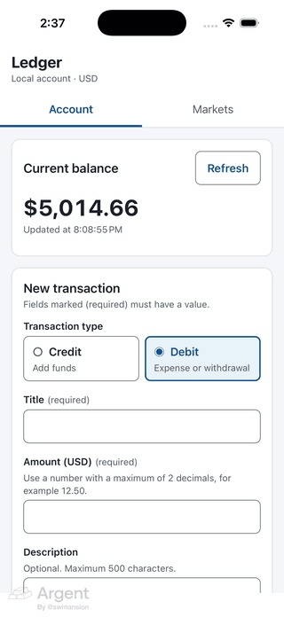

# Ledger

Ledger is a simple local account app.
You use it to record credits (add funds) and debits (expenses and withdrawals).
Each transaction has a title, an amount, a description and an optional receipt image.
The app also shows mock stock prices. The mock server makes these requests slow and makes them fail at random.

The repository is a pnpm monorepo.
It contains an Expo React Native app, a React web app, a shared UI library and a Node.js mock API.
All code is TypeScript.

> All documents in this repository use ASD-STE100 Simplified Technical English. See [docs/STE-WRITING-RULES.md](docs/STE-WRITING-RULES.md).

> **Reviewers:** start with the [Reviewer guide](docs/REVIEWER-GUIDE.md). It tells you where to look first, the important trade-offs and where the evidence is.

<p align="center">
  
</p>

## Contents

1. [What the app does](#1-what-the-app-does)
2. [Repository structure](#2-repository-structure)
3. [Requirements](#3-requirements)
4. [Install](#4-install)
5. [Start the apps](#5-start-the-apps)
6. [Run the tests](#6-run-the-tests)
7. [Run the Detox end-to-end tests (iOS)](#7-run-the-detox-end-to-end-tests-ios)
8. [HTTP API](#8-http-api)
9. [Accessibility](#9-accessibility)
10. [Design decisions](#10-design-decisions)
11. [AI in the development process](#11-ai-in-the-development-process)
12. [Troubleshooting](#12-troubleshooting)

## 1. What the app does

| Requirement                                                                                  | Where                                                                                                                                                              |
| -------------------------------------------------------------------------------------------- | ------------------------------------------------------------------------------------------------------------------------------------------------------------------ |
| Record one transaction (date/time, amount, type, description)                                | `packages/features/src/account/TransactionForm.tsx`                                                                                                                |
| Refuse a transaction that makes the balance negative                                         | `apps/server/src/domain/ledger.ts` (server rule), error shown in the form banner                                                                                   |
| Show the account balance                                                                     | `packages/features/src/account/BalanceCard.tsx`                                                                                                                    |
| Show the last 5 transactions                                                                 | `packages/features/src/account/RecentTransactions.tsx`                                                                                                             |
| HTTP API: read balance, read last 5, write one, only 200 or 500                              | `apps/server/src/app.ts`, [OpenAPI document](apps/server/openapi.json)                                                                                             |
| Title, description and image for expenses                                                    | `NewTransaction` schema in `packages/contracts/src/schemas.ts`                                                                                                     |
| Global state (Redux Toolkit)                                                                 | `packages/core/src/store/`                                                                                                                                         |
| Stock data with React Query (slow, fail, retry, debounce, fallback)                          | `packages/core/src/stocks/`, `packages/features/src/markets/MarketsScreen.tsx`                                                                                     |
| Shared UI library for web and mobile, with Storybook                                         | `packages/ui/`                                                                                                                                                     |
| OpenAPI document, validated with Zod                                                         | `packages/contracts/src/openapi.ts`, `apps/server/openapi.json`                                                                                                    |
| Unit tests and Detox tests                                                                   | `**/test/`, `apps/mobile/__tests__/`, `apps/mobile/e2e/`                                                                                                           |
| WCAG 2.1 AA (Section 504)                                                                    | [docs/ACCESSIBILITY.md](docs/ACCESSIBILITY.md)                                                                                                                     |
| Two AI skills                                                                                | [.claude/skills/shared-ui-library](.claude/skills/shared-ui-library/SKILL.md), [.claude/skills/accessibility-review](.claude/skills/accessibility-review/SKILL.md) |
| Take a receipt photo with a native Nitro module; share pixels with JS through an ArrayBuffer | `packages/native-camera`, [docs/NATIVE-CAMERA.md](docs/NATIVE-CAMERA.md)                                                                                           |
| Trace one user request end to end (Reference ID)                                             | [docs/TRACING.md](docs/TRACING.md)                                                                                                                                 |
| Keep the data in a local JSON file, with showcase data                                       | `apps/server/data/`, [docs/DATA-STORAGE.md](docs/DATA-STORAGE.md)                                                                                                  |

## 2. Repository structure

The repository uses an `apps/` and `packages/` split.
An app can use a package. A package cannot use an app.

```text
apps/
  mobile/      Expo React Native app (iOS, Android). Jest tests and Detox tests.
  web/         React web app (Vite + react-native-web). Same screens as mobile.
  server/      Node.js mock API (Express 5, Zod, OpenAPI 3.1, Swagger UI).
packages/
  contracts/   Zod schemas, TypeScript types, OpenAPI document builder. Server and clients use it.
  core/        Platform-independent logic: API client, Redux store, React Query hooks, formatting.
  ui/          Design system: tokens, accessible components, Storybook.
  features/    Shared screens: Account, Markets. Mobile and web use them.
  native-camera/ Nitro native module (Swift, Kotlin): camera, shared pixel memory, PhotoView.
docs/          Plan, architecture, accessibility, decisions (ADR).
.claude/       AI skills and settings.
```

The dependency direction is: `contracts` → `core` → `features` ← `ui`. The apps use `features`.
Read [docs/ARCHITECTURE.md](docs/ARCHITECTURE.md) for the full description.

## 3. Requirements

| Tool                        | Version                         | Necessary for                             |
| --------------------------- | ------------------------------- | ----------------------------------------- |
| Node.js                     | 22.12 or later (24 recommended) | All                                       |
| pnpm                        | 12 (`corepack enable`)          | All                                       |
| Xcode and an iOS simulator  | Xcode 26 or later               | iOS app, iOS Detox tests                  |
| Android Studio, an emulator | API 35 or later                 | Android app (no Android end-to-end tests) |
| applesimutils               | latest                          | iOS Detox tests only                      |

## 4. Install

1. Enable Corepack. This gives the correct pnpm version.

   ```sh
   corepack enable
   ```

2. Install the dependencies from the repository root.

   ```sh
   pnpm install
   ```

3. Make sure that the checks pass.

   ```sh
   pnpm verify
   ```

## 5. Start the apps

### 5.1 Start the mock API

Start the API first. The web app and the mobile app use it.

```sh
pnpm dev:server
```

| URL                                | Content              |
| ---------------------------------- | -------------------- |
| http://localhost:4000/api/v1       | API                  |
| http://localhost:4000/docs         | Swagger UI           |
| http://localhost:4000/openapi.json | OpenAPI 3.1 document |

You can change the server behavior with environment variables:

| Variable               | Default                         | Effect                                                  |
| ---------------------- | ------------------------------- | ------------------------------------------------------- |
| `PORT`                 | `4000`                          | HTTP port                                               |
| `CHAOS_FAILURE_RATE`   | `0.3`                           | Probability (0 to 1) that a stock request fails         |
| `CHAOS_MIN_LATENCY_MS` | `150`                           | Minimum delay of a stock request                        |
| `CHAOS_MAX_LATENCY_MS` | `2500`                          | Maximum delay of a stock request                        |
| `INITIAL_BALANCE`      | `0`                             | Start balance in USD                                    |
| `LOG_REQUESTS`         | `true`                          | Write one log line for each request                     |
| `DATA_FILE`            | `apps/server/data/ledger.json`  | The ledger data file (JSON)                             |
| `SEED_ON_FIRST_START`  | `true`                          | Copy `data/seed.json` when the data file does not exist |
| `TRACE_FILE`           | `apps/server/data/traces.jsonl` | Request trace log (JSON Lines)                          |

Example: make every stock request fail, to see the fallback data.

```sh
CHAOS_FAILURE_RATE=1 pnpm dev:server
```

> NOTE: The server keeps the ledger in `apps/server/data/ledger.json`. At the first start it copies 13 showcase transactions from `data/seed.json`. To start again from the showcase data, run `pnpm --filter @ledger/server data:reset`. Read [docs/DATA-STORAGE.md](docs/DATA-STORAGE.md).

### 5.2 Start the web app

```sh
pnpm dev:web
```

Open http://localhost:5173. To use a different API, set `VITE_API_URL`.

### 5.3 Start the mobile app

The app uses native modules (the image picker and the Nitro camera module in `packages/native-camera`), so it needs a development build. Expo Go is not sufficient.

On the iOS simulator there is no camera. The "Take photo" button then gives a generated sample receipt, so you can see the native preview and the shared-memory details. On a device or on the Android emulator, the system camera opens.

1. Start the API (step 5.1).
2. Build and start the iOS app on a simulator.

   ```sh
   pnpm --filter @ledger/mobile ios
   ```

3. Or build and start the Android app on an emulator.

   ```sh
   pnpm --filter @ledger/mobile android
   ```

The app finds the API in this order:

1. The `EXPO_PUBLIC_API_URL` environment variable.
2. The host of the Metro server (for a physical device on the same network).
3. `http://localhost:4000` on iOS, `http://10.0.2.2:4000` on Android.

### 5.4 Start Storybook

```sh
pnpm storybook
```

Open http://localhost:6006. Use the **Theme** toolbar to see the light and dark themes.
Use the **Accessibility** panel to see the axe-core results for each story.

## 6. Run the tests

Run all unit tests:

```sh
pnpm test
```

| Package                  | Runner                     | What the tests check                                                     |
| ------------------------ | -------------------------- | ------------------------------------------------------------------------ |
| `packages/contracts`     | Vitest                     | Zod rules, money helpers, the OpenAPI document is valid                  |
| `apps/server`            | Vitest + Supertest         | Ledger rules, all endpoints, 200/500 contract, chaos, idempotency        |
| `packages/core`          | Vitest + Testing Library   | API client errors, Redux slices, safe write retries, error reports       |
| `packages/ui`            | Vitest + react-native-web  | Roles, names and states on the web; color contrast of all theme tokens   |
| `packages/features`      | Vitest + react-native-web  | Full Account flow: validation, credit, refused debit; error boundary     |
| `apps/mobile`            | Jest (jest-expo) + RNTL 14 | Native accessibility mapping (roles, states, hints) of the same screens  |
| `packages/native-camera` | Vitest                     | Pixel analysis on an RGBA ArrayBuffer (row padding, sampling, luminance) |

Other checks:

```sh
pnpm typecheck        # TypeScript in all packages
pnpm lint             # ESLint, including the "use @ledger/ui" rule
pnpm openapi:check    # apps/server/openapi.json agrees with the Zod schemas
pnpm compiler:report  # the React Compiler compiles all components (no bail-outs)
pnpm verify           # all of the above
```

## 7. Run the Detox end-to-end tests (iOS)

The Detox tests start the mock API themselves. The API uses no chaos and an empty ledger.

> CAUTION: Stop `pnpm dev:server` before you run the Detox tests. The tests need port 4000 and an empty ledger.

### 7.1 iOS

1. Install applesimutils.

   ```sh
   brew tap wix/brew && brew install wix/brew/applesimutils
   ```

2. Build the release app. This step generates the `ios` folder and installs the pods.

   ```sh
   pnpm e2e:build:ios
   ```

3. Run the tests.

   ```sh
   pnpm e2e:test:ios
   ```

The configuration uses an "iPhone 17 Pro" simulator. To use a different simulator, change `devices.simulator` in `apps/mobile/.detoxrc.json`.

Last result: 8 of 8 tests passed on 2026-10-15 (iPhone 17 Pro, iOS 26.5, release build). See [docs/REVIEWER-GUIDE.md](docs/REVIEWER-GUIDE.md), section 4.1.

### 7.2 Android

The Detox tests run on iOS only. The Android app builds and runs (`pnpm --filter @ledger/mobile android`), but the project has no Android end-to-end tests.

## 8. HTTP API

The [OpenAPI document](apps/server/openapi.json) is the reference. Swagger UI shows it at http://localhost:4000/docs.

| Method | Path                                 | Result                                         |
| ------ | ------------------------------------ | ---------------------------------------------- |
| GET    | `/api/v1/balance`                    | Current balance                                |
| GET    | `/api/v1/transactions?limit=5`       | Last transactions, newest first                |
| POST   | `/api/v1/transactions`               | Records one transaction, sends new balance     |
| GET    | `/api/v1/stocks/quotes?symbols=AAPL` | Mock quotes (random delay and failure)         |
| GET    | `/api/v1/stocks/search?q=app`        | Stock search (random delay and failure)        |
| GET    | `/api/v1/health`                     | Service status                                 |
| GET    | `/api/v1/traces/{traceId}`           | Server events of one user action (diagnostics) |

The assignment allows only "200 OK" and "500 Internal Server Error".
For this reason, every error uses status 500 and a body with a stable `error.code`:

```json
{
  "error": {
    "code": "INSUFFICIENT_FUNDS",
    "message": "The transaction is refused. The balance cannot go below $0.00. Available balance: $20.00."
  }
}
```

| `error.code`             | Cause                                                              | Client retries?                                 |
| ------------------------ | ------------------------------------------------------------------ | ----------------------------------------------- |
| `INSUFFICIENT_FUNDS`     | The debit makes the balance less than 0                            | No                                              |
| `IDEMPOTENCY_KEY_REUSED` | The `idempotency-key` belongs to a transaction with different data | No                                              |
| `VALIDATION_FAILED`      | The request data is not correct (`details` has the fields)         | No                                              |
| `UPSTREAM_UNAVAILABLE`   | Random failure of the mock market service                          | Yes                                             |
| `INTERNAL_ERROR`         | Unexpected error                                                   | Yes (writes too, with the same idempotency key) |

Example request:

```sh
curl -X POST http://localhost:4000/api/v1/transactions \
  -H 'Content-Type: application/json' \
  -H 'idempotency-key: 6f1c2a3e-8b4d-4f0a-9c1e-2d3b4a5c6d7e' \
  -d '{"type":"credit","amount":120.50,"title":"Salary","description":"October"}'
```

Send the same command again. The server does not record a second transaction. It sends the first transaction and the header `idempotent-replayed: true`. Read [ADR 0011](docs/adr/0011-idempotency-key-for-writes.md).

## 9. Accessibility

The app follows WCAG 2.1 Level AA, as Section 504 of the Rehabilitation Act requires for patient-facing healthcare apps.
[docs/ACCESSIBILITY.md](docs/ACCESSIBILITY.md) gives the conformance table and the manual test procedure for VoiceOver and TalkBack.

## 10. Design decisions

Each important decision has an Architecture Decision Record (ADR) in [docs/adr](docs/adr).

| ADR                                                           | Decision                                                                  |
| ------------------------------------------------------------- | ------------------------------------------------------------------------- |
| [0001](docs/adr/0001-monorepo-apps-packages.md)               | pnpm monorepo with `apps/` and `packages/`, packages as TypeScript source |
| [0002](docs/adr/0002-pnpm-hoisted-node-linker.md)             | pnpm `nodeLinker: hoisted`                                                |
| [0003](docs/adr/0003-redux-toolkit-and-react-query.md)        | Redux Toolkit for app state, React Query for stock data                   |
| [0004](docs/adr/0004-error-contract-200-500.md)               | Only 200 and 500, with a stable error code                                |
| [0005](docs/adr/0005-money-in-integer-cents.md)               | Money calculations in integer cents                                       |
| [0006](docs/adr/0006-shared-ui-with-react-native-web.md)      | One UI library for mobile and web with react-native-web                   |
| [0007](docs/adr/0007-zod-as-single-source-of-truth.md)        | Zod schemas as the single source of truth for the API                     |
| [0008](docs/adr/0008-nitro-camera-zero-copy.md)               | Nitro module with a shared ArrayBuffer for the receipt photo              |
| [0009](docs/adr/0009-w3c-trace-context.md)                    | End-to-end tracing with W3C Trace Context                                 |
| [0010](docs/adr/0010-json-file-storage.md)                    | Local JSON file for the ledger (showcase)                                 |
| [0011](docs/adr/0011-idempotency-key-for-writes.md)           | Idempotency key: safe retries for transaction writes                      |
| [0012](docs/adr/0012-error-boundaries-and-error-reporting.md) | Error boundaries and error reports without personal data                  |
| [0013](docs/adr/0013-react-compiler.md)                       | React Compiler on mobile and web, checked by `pnpm compiler:report`       |

The implementation plan is in [docs/PLAN.md](docs/PLAN.md).

Other documents:

| Document                                             | Content                                                                          |
| ---------------------------------------------------- | -------------------------------------------------------------------------------- |
| [docs/NATIVE-CAMERA.md](docs/NATIVE-CAMERA.md)       | The Nitro camera module and the shared-memory (zero-copy) image path             |
| [docs/TRACING.md](docs/TRACING.md)                   | End-to-end request tracing and the procedure to find the cause of a user problem |
| [docs/DATA-STORAGE.md](docs/DATA-STORAGE.md)         | The local JSON data file, the seed data and the integrity rules                  |
| [docs/SECURITY-PRIVACY.md](docs/SECURITY-PRIVACY.md) | Data inventory, threats, privacy rules and the production checklist              |
| [docs/ARCHITECTURE.md](docs/ARCHITECTURE.md)         | Layers, state ownership and data flow                                            |
| [docs/ACCESSIBILITY.md](docs/ACCESSIBILITY.md)       | WCAG 2.1 AA conformance table and manual test procedure                          |

## 11. AI in the development process

[docs/AI-WORKFLOW.md](docs/AI-WORKFLOW.md) tells how we used an AI coding agent and how we control its output.
The repository includes the agent instructions ([CLAUDE.md](CLAUDE.md)) and two skills:

- `shared-ui-library`: rules to add or change a component in `packages/ui`.
- `accessibility-review`: a WCAG 2.1 AA review procedure for React Native screens.

## 12. Troubleshooting

| Problem                                                      | Cause                                                           | Action                                                                                                  |
| ------------------------------------------------------------ | --------------------------------------------------------------- | ------------------------------------------------------------------------------------------------------- |
| The mobile app shows "The app cannot connect to the server." | The API does not operate, or the device cannot reach it         | Start `pnpm dev:server`. On a physical device, set `EXPO_PUBLIC_API_URL=http://<computer-LAN-IP>:4000`. |
| Detox stops with "A server already uses port 4000."          | `pnpm dev:server` operates                                      | Stop the dev server. Then run the tests again.                                                          |
| The iOS build fails after a dependency change                | The generated `ios` folder is old                               | Run `pnpm --filter @ledger/mobile prebuild`. Then build again.                                          |
| The server stops with "The data file … is not valid"         | `ledger.json` was changed by hand, or its balances do not agree | Correct the file, or run `pnpm --filter @ledger/server data:reset`.                                     |
| The web app has no "Take photo" button                       | The web app has no native camera module                         | This is correct. Use "Add image".                                                                       |
| A user gives a Reference ID                                  | —                                                               | Follow the procedure in [docs/TRACING.md](docs/TRACING.md), section 6.                                  |
| pnpm shows "Ignored build scripts"                           | pnpm blocks unknown install scripts                             | Add the package to `allowBuilds` in `pnpm-workspace.yaml` only if it is necessary.                      |
