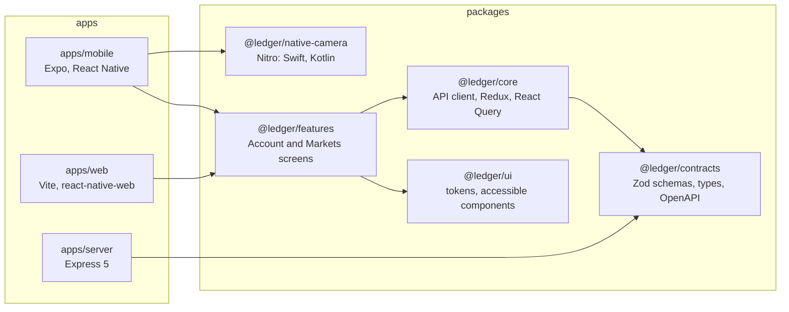
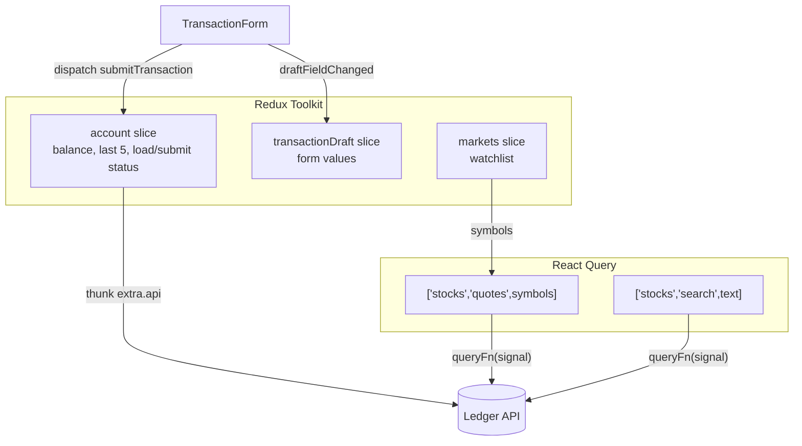
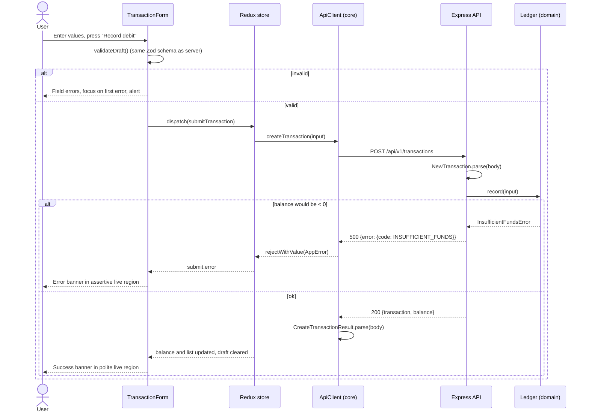

# Architecture

This document describes the structure of the Ledger code and the flow of data.

## 1. Layers

| Package / app             | Responsibility                                                            | It must not                                               |
| ------------------------- | ------------------------------------------------------------------------- | --------------------------------------------------------- |
| `contracts`               | Define the API data (Zod) and generate the OpenAPI document.              | Import React or Node.js server code.                      |
| `core`                    | Call the API, keep the app state, format values, validate the form.       | Import `react-native`. It must run in Node.js tests.      |
| `ui`                      | Give accessible, themed components that use only React Native primitives. | Know about transactions or the API.                       |
| `features`                | Compose screens from `ui` and `core`.                                     | Use raw `Text`, `Pressable` or `TextInput` (ESLint rule). |
| `apps/mobile`, `apps/web` | Start the app, give platform services (image picker), give the API URL.   | Contain screen logic.                                     |
| `apps/server`             | Keep the ledger, apply the balance rule, simulate a slow market service.  | Trust the request data without Zod validation.            |

## 2. Source packages

The packages have no build step. Each `package.json` points to `src/index.ts`.
Metro (mobile), Vite (web, Storybook), Vitest and tsx (server) compile the TypeScript source directly.
This keeps one source of truth and gives "go to definition" into the real code.

## 3. State ownership

| State                                       | Owner                      | Reason                                                                                                         |
| ------------------------------------------- | -------------------------- | -------------------------------------------------------------------------------------------------------------- |
| Balance, last 5 transactions, submit status | Redux (`account`)          | The assignment asks for a global state library. A write changes two views (balance and list) at the same time. |
| Form values                                 | Redux (`transactionDraft`) | The values must stay when the tab or the layout changes.                                                       |
| Watchlist                                   | Redux (`markets`)          | UI state that two cards use.                                                                                   |
| Stock quotes and search results             | React Query                | Server cache: retry, stale data, refetch interval and cancellation are built in.                               |

Read [ADR 0003](adr/0003-redux-toolkit-and-react-query.md) for the full reason.

## 4. Flow: record a transaction

## 5. Resilience of the stock data

The mock server adds a random delay (150 ms to 2500 ms) and a random failure (30 %) to the stock endpoints.
The client handles this with the steps that follow:

| Mechanism    | Where                | Behavior                                                                                                                  |
| ------------ | -------------------- | ------------------------------------------------------------------------------------------------------------------------- |
| Timeout      | `createApiClient`    | A request stops after 10 s and gives `TIMEOUT`.                                                                           |
| Retry        | `shouldRetry`        | A maximum of 3 retries, only for temporary errors (`UPSTREAM_UNAVAILABLE`, `INTERNAL_ERROR`, `NETWORK_ERROR`, `TIMEOUT`). |
| Backoff      | `retryDelay`         | Exponential backoff with "equal jitter": 250–500 ms, 500–1000 ms, 1–2 s, to a maximum of 8 s.                             |
| Debounce     | `useStockSearch`     | The search sends one request 350 ms after the last key press.                                                             |
| Cancellation | React Query `signal` | A new search text cancels the old request.                                                                                |
| Stale data   | `useStockQuotes`     | If a refetch fails, the app keeps the last good data and shows "Delayed".                                                 |
| Fallback     | `FALLBACK_QUOTES`    | If no request was successful, the app shows a bundled snapshot with its date ("Offline snapshot").                        |
| Visibility   | `MarketsScreen`      | The UI shows "Retry 2 of 3", "Delayed" or "Offline snapshot" in text, and a "Try again" button.                           |

## 6. Platform differences

The shared screens call the `PlatformServices` interface (dependency inversion).
Each app gives its own implementation:

| Service          | Mobile                                                              | Web                                              |
| ---------------- | ------------------------------------------------------------------- | ------------------------------------------------ |
| `pickImage()`    | `expo-image-picker` (system photo picker, JPEG quality 0.4, base64) | File input, resize to 1280 px, JPEG quality 0.7  |
| Refetch on focus | `AppState` → React Query `focusManager`                             | Browser `visibilitychange` (React Query default) |
| API URL          | `EXPO_PUBLIC_API_URL`, Metro host, or emulator default              | `VITE_API_URL` or `http://localhost:4000`        |

## 7. Error model

Every error that the UI can show is an `AppError` (`{ code, message }`).
It is serializable, so Redux can keep it.

| Source               | Codes                                                                                                         |
| -------------------- | ------------------------------------------------------------------------------------------------------------- |
| Server (`ErrorBody`) | `INSUFFICIENT_FUNDS`, `VALIDATION_FAILED`, `IDEMPOTENCY_KEY_REUSED`, `UPSTREAM_UNAVAILABLE`, `INTERNAL_ERROR` |
| Client (`ApiError`)  | `NETWORK_ERROR`, `TIMEOUT`, `INVALID_RESPONSE`                                                                |

The client validates every response with Zod. A response with an unknown shape gives `INVALID_RESPONSE`.
The UI never receives data that does not agree with the contract.

### 7.1 Retry rules

| Request              | Retry                                                                             | Why it is safe                                                           |
| -------------------- | --------------------------------------------------------------------------------- | ------------------------------------------------------------------------ |
| Stock reads          | React Query: 3 retries, exponential backoff, then fallback data                   | A read changes nothing                                                   |
| Account reads        | The user selects "Try again"                                                      | A read changes nothing                                                   |
| `POST /transactions` | Thunk: 2 retries (400 ms, 1200 ms) for network errors, timeouts, `INTERNAL_ERROR` | The idempotency key ([ADR 0011](adr/0011-idempotency-key-for-writes.md)) |

### 7.2 Render errors

An error boundary for each tab and one for the full app catch render errors. The fallback shows a Reference ID. `reportError` sends a report without personal data. Read [ADR 0012](adr/0012-error-boundaries-and-error-reporting.md).

## 8. Cross-cutting topics

| Topic                                             | Document                                                 |
| ------------------------------------------------- | -------------------------------------------------------- |
| Native camera module and the zero-copy image path | [NATIVE-CAMERA.md](NATIVE-CAMERA.md)                     |
| End-to-end request tracing (W3C Trace Context)    | [TRACING.md](TRACING.md)                                 |
| Data file, seed data and integrity rules          | [DATA-STORAGE.md](DATA-STORAGE.md)                       |
| Data inventory, threats and production changes    | [SECURITY-PRIVACY.md](SECURITY-PRIVACY.md)               |
| Automatic memoization (React Compiler)            | [adr/0013-react-compiler.md](adr/0013-react-compiler.md) |
