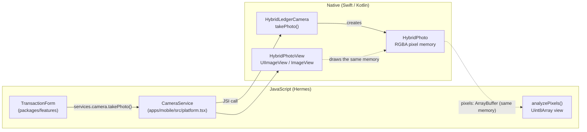

# Native camera module (Nitro) and shared memory

This document describes the `@ledger/native-camera` package.
The package takes a receipt photo and shows it on the screen.
JavaScript reads the photo pixels directly in native memory. No copy and no base64 conversion are necessary.

## 1. Purpose

A transaction can have a receipt image. A usual React Native image flow does these steps:

1. The native camera writes a JPEG file.
2. Native code reads the file and encodes it as a base64 string.
3. The string crosses to JavaScript (one large string copy).
4. JavaScript gives the string to `<Image source={{ uri: 'data:...' }}>`.
5. Native code decodes the base64 string and the JPEG again, and shows the image.

This flow copies the image several times and decodes it two times. On a large photo this takes visible time and memory.

The Nitro module does these steps instead:

1. Native code decodes the photo one time into RGBA pixels in native memory.
2. JavaScript gets an `ArrayBuffer` that **wraps** this memory. JavaScript reads the pixels in place.
3. A native view (`PhotoView`) gets the photo object as a prop and draws the same pixels.
4. Only for the upload, native code encodes a JPEG on a background thread.

## 2. Why Nitro

[Nitro Modules](https://nitro.margelo.com) (`react-native-nitro-modules` 0.37) is a framework for native modules on the React Native New Architecture.

| Need                 | What Nitro gives                                                                                                                                                        |
| -------------------- | ----------------------------------------------------------------------------------------------------------------------------------------------------------------------- |
| Type safety          | You write the API one time in TypeScript (`*.nitro.ts`). `nitrogen` generates the C++, Swift and Kotlin bindings. A wrong type is a compile error, not a runtime crash. |
| Speed                | JavaScript calls native code through JSI (direct C++ calls). There is no JSON bridge and no serialization.                                                              |
| Shared memory        | The `ArrayBuffer` type can wrap native memory without a copy.                                                                                                           |
| Native objects in JS | A `HybridObject` (here: `Photo`) is a native object that JavaScript holds by reference.                                                                                 |
| Native views         | A `HybridView` (here: `PhotoView`) takes a `HybridObject` as a prop.                                                                                                    |

## 3. Architecture



The shared screens (`packages/features`) do not import the native module.
They call the `CameraService` interface of `PlatformServices`. The mobile app gives the implementation.
The web app has no camera service, so the web form does not show the "Take photo" button.

## 4. The API (spec)

File: `packages/native-camera/src/specs/LedgerCamera.nitro.ts`.

| Type                          | Member                                                 | Description                                                         |
| ----------------------------- | ------------------------------------------------------ | ------------------------------------------------------------------- |
| `LedgerCamera` (HybridObject) | `isCameraAvailable: boolean`                           | False on a simulator.                                               |
|                               | `takePhoto(maxDimension): Promise<Photo \| undefined>` | Opens the system camera. `undefined` when the user cancels.         |
| `Photo` (HybridObject)        | `width`, `height`, `bytesPerRow`                       | The pixel layout.                                                   |
|                               | `pixels: ArrayBuffer`                                  | RGBA, 8 bits per channel, in native memory. Shared with JavaScript. |
|                               | `source: 'camera' \| 'sample'`                         | `sample` is a generated image for a device without a camera.        |
|                               | `decodeMs: number`                                     | Native time to decode and scale the photo.                          |
|                               | `toJpegDataUri(quality): Promise<string>`              | JPEG encoding on a background thread. For the upload only.          |
| `PhotoView` (HybridView)      | `photo?: Photo`                                        | Draws the photo.                                                    |

## 5. Memory model

### 5.1 iOS (Swift)

| Step                                                        | Code                                                                                | Copy?                       |
| ----------------------------------------------------------- | ----------------------------------------------------------------------------------- | --------------------------- |
| Allocate one block for the pixels                           | `UnsafeMutablePointer<UInt8>.allocate(capacity:)`                                   | —                           |
| Draw the camera image into the block (scale, EXIF rotation) | `CGContext(data: block, ...)`                                                       | Decode (necessary one time) |
| Give the block to JavaScript                                | `ArrayBuffer.wrap(dataWithoutCopy: block, size:, onDelete: { block.deallocate() })` | **No**                      |
| Show the block on the screen                                | `CGDataProvider(dataInfo:data:size:releaseData:)` → `CGImage` → `UIImageView`       | **No**                      |

The pixel memory has one owner chain:

- The `ArrayBuffer` is an **owning** buffer. Its `onDelete` callback frees the block.
- The `CGDataProvider` retains the `HybridPhoto` object (`Unmanaged.passRetained`). UIKit can draw the image after JavaScript releases the photo; the memory stays valid.
- The block is freed when the JavaScript object, the native view and UIKit no longer use it.

### 5.2 Android (Kotlin)

| Step                                                         | Code                                                      | Copy?                       |
| ------------------------------------------------------------ | --------------------------------------------------------- | --------------------------- |
| Decode the file with a power-of-two sample size              | `BitmapFactory.decodeFile` + `inSampleSize`               | Decode (necessary one time) |
| Scale and apply the EXIF rotation                            | `Bitmap.createScaledBitmap`, `Matrix.postRotate`          | —                           |
| Copy the pixels into a direct buffer (outside the Java heap) | `ByteBuffer.allocateDirect` + `Bitmap.copyPixelsToBuffer` | **One copy**                |
| Give the buffer to JavaScript                                | `ArrayBuffer.wrap(byteBuffer)`                            | **No**                      |
| Show the bitmap                                              | `ImageView.setImageBitmap(photo.bitmap)`                  | **No**                      |

Android `Bitmap` objects cannot wrap foreign memory. For this reason, Android has one native-to-native copy.
JavaScript still reads the direct buffer without a copy.
A future version can use `HardwareBuffer` (`ArrayBuffer.wrap(hardwareBuffer)` and `Bitmap.wrapHardwareBuffer`) to remove this copy.

### 5.3 JavaScript

```ts
const photo = await getLedgerCamera().takePhoto(1280);
const bytes = new Uint8Array(photo.pixels); // a view on native memory, not a copy
const stats = analyzePixels(photo.pixels, photo.width, photo.height, photo.bytesPerRow);
```

`analyzePixels` (`packages/native-camera/src/analysis.ts`) samples one pixel in each 8 × 8 block and computes the Rec. 709 luminance.
If the mean luminance is below 60, the form shows the warning "The photo is dark. The receipt text can be hard to read."
This check runs in JavaScript on the native memory, without a copy.

### 5.4 Garbage collection

Hermes does not know the size of native memory that a JavaScript object holds.
Each `Photo` reports its size with `memorySize` (`width × height × 4` bytes, plus the bitmap on Android).
Nitro gives this value to Hermes, so the garbage collector frees unused photos sooner.

## 6. Threads

| Work                              | Thread                                                            |
| --------------------------------- | ----------------------------------------------------------------- |
| `takePhoto()` call                | The JS thread returns at once with a `Promise`.                   |
| Show the camera UI                | Main thread (`@MainActor` on iOS, `Dispatchers.Main` on Android). |
| Decode, scale, copy to the buffer | Background (`Promise.async`: Swift `Task`, Kotlin coroutine).     |
| `toJpegDataUri()`                 | Background.                                                       |
| Set the `PhotoView` image         | Main thread.                                                      |
| `analyzePixels()`                 | JS thread (about 1 to 3 ms for 1280 × 960, see section 9).        |

## 7. Platform behavior

| Platform      | Camera                                                               | Permission                                                                        |
| ------------- | -------------------------------------------------------------------- | --------------------------------------------------------------------------------- |
| iOS device    | `UIImagePickerController` (system camera)                            | `NSCameraUsageDescription` (set by the `expo-image-picker` config plugin)         |
| iOS simulator | No camera. The module draws a sample receipt (`source: 'sample'`).   | —                                                                                 |
| Android       | System camera app (`ACTION_IMAGE_CAPTURE` with a `FileProvider` URI) | None, unless another library declares `CAMERA`. Then the module asks at run time. |
| Web           | No camera service. The button is not shown.                          | —                                                                                 |

## 8. Accessibility

- The `PhotoView` is not an accessible element itself. A wrapper `View` has `role="img"` and the label "Receipt photo for <title>" (WCAG 1.1.1).
- The details line and the dark-photo warning are text, not only color (WCAG 1.4.1).
- The "Take photo" button has the hint "Opens the camera."

## 9. Measured results

The values below come from the release build on the devices in the table.
The numbers depend on the device. Run the app and read the details line below the preview to see the values on your device.

The same test also recorded the transaction with the photo: the JPEG data URI (quality 0.6) was 69 KB, and the server stored it in `ledger.json`.

NOTE: The Android implementation compiles in the release build. It was not run on a device or an emulator, because the project tests on iOS only.

| Device                                                               | Photo                     | Native decode (`decodeMs`) | JS analysis on shared memory   | Shared buffer |
| -------------------------------------------------------------------- | ------------------------- | -------------------------- | ------------------------------ | ------------- |
| iPhone 17 Pro simulator (iOS 26.5), release build, Apple silicon Mac | 960 × 1280 sample receipt | 4 ms                       | 1.9 ms (19,200 sampled pixels) | 4.7 MB        |

## 10. Files

| File                                                     | Content                                                |
| -------------------------------------------------------- | ------------------------------------------------------ |
| `packages/native-camera/src/specs/LedgerCamera.nitro.ts` | The TypeScript spec.                                   |
| `packages/native-camera/nitrogen/generated/`             | Generated bindings (C++, Swift, Kotlin). Do not edit.  |
| `packages/native-camera/ios/*.swift`                     | iOS implementation.                                    |
| `packages/native-camera/android/src/main/java/.../*.kt`  | Android implementation.                                |
| `packages/native-camera/src/index.ts`                    | `getLedgerCamera()`, `PhotoView`.                      |
| `packages/native-camera/src/analysis.ts`                 | Pixel analysis (pure TypeScript, unit tests).          |
| `apps/mobile/src/platform.tsx`                           | `CameraService` implementation for the shared screens. |

## 11. Procedure: change the API

1. Change `src/specs/LedgerCamera.nitro.ts`.
2. Generate the bindings.

   ```sh
   pnpm --filter @ledger/native-camera codegen
   ```

3. Change the Swift and the Kotlin classes. The compiler shows each missing member.
4. Rebuild the app.

   ```sh
   pnpm --filter @ledger/mobile prebuild
   pnpm --filter @ledger/mobile ios
   ```

CAUTION: Do not edit files in `nitrogen/generated`. The next `codegen` run replaces them.
