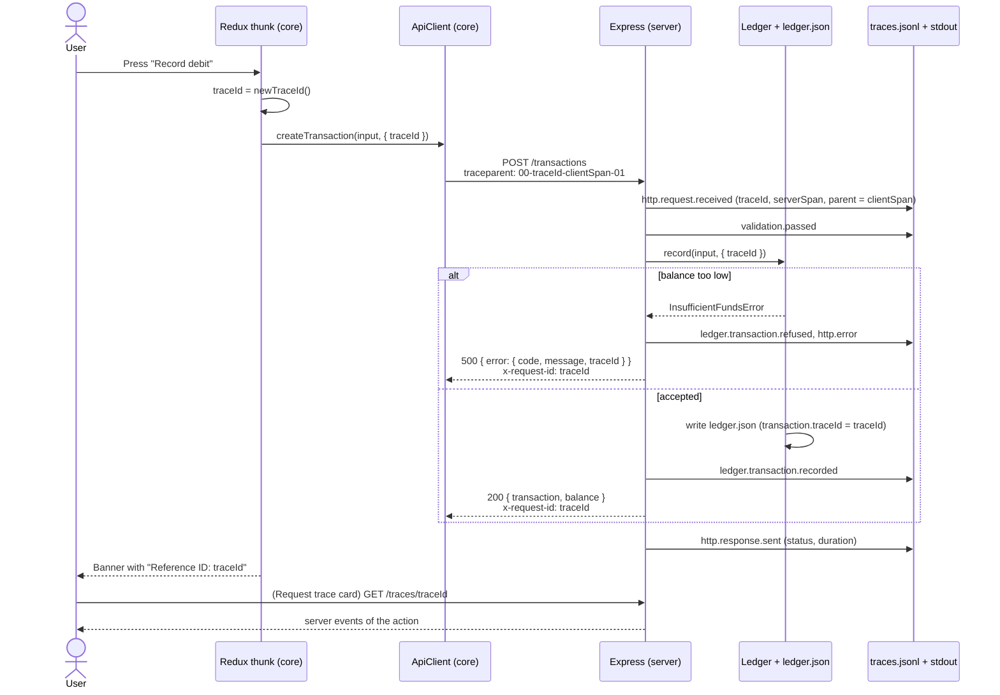

# End-to-end request tracing

This document describes how Ledger follows one user action from the app to the data file.
Use it to find the cause of a problem that a user reports.

## 1. Standard

Ledger uses [W3C Trace Context](https://www.w3.org/TR/trace-context/). The header is:

```text
traceparent: 00-<trace-id>-<span-id>-01
              │   32 hex       16 hex   └ sampled
              └ version
```

| Term     | Meaning in Ledger                                                                            |
| -------- | -------------------------------------------------------------------------------------------- |
| Trace ID | One user action, for example "Record debit". The UI shows it as the **Reference ID**.        |
| Span ID  | One step of the action: one HTTP request of the client, or the server work for that request. |

The format is the same as in OpenTelemetry. A tracing back end (for example Jaeger or Grafana Tempo) can read these IDs without a change.

## 2. Flow



## 3. Where the trace ID appears

| Place               | Example                                                                                            |
| ------------------- | -------------------------------------------------------------------------------------------------- |
| Request header      | `traceparent: 00-4bf92f35…-00f067aa0ba902b7-01`                                                    |
| Response headers    | `x-request-id: 4bf92f35…`, `traceparent: 00-4bf92f35…-<server span>-01`                            |
| Error body          | `{ "error": { "code": "INSUFFICIENT_FUNDS", "message": "…", "traceId": "4bf92f35…" } }`            |
| Stored transaction  | `ledger.json` → `transactions[].traceId`                                                           |
| Server log (stdout) | one JSON line per step: `{"time":…,"traceId":…,"spanId":…,"event":"ledger.transaction.refused",…}` |
| Trace file          | `apps/server/data/traces.jsonl` (one JSON line per step)                                           |
| API                 | `GET /api/v1/traces/{traceId}`                                                                     |
| App                 | Success and error banners: "Reference ID: …". The **Request trace** card shows all steps.          |

## 4. Rules in the code

1. One user action has one trace ID. Example: "load account" sends two requests (balance and list). Both requests use the same trace ID (`fetchAccount` in `packages/core/src/store/accountSlice.ts`).
2. Each HTTP request has a new span ID (`createApiClient`).
3. The server always answers with `x-request-id`. If the client sends no valid `traceparent`, the server starts a new trace.
4. A client error without a server answer (for example `NETWORK_ERROR`) still has the client trace ID. The user can give it to support.
5. The trace endpoint, the health check and the API documents are not traced, so they do not fill the log.

## 5. Server events

| Event                          | When                                                              | Attributes                                                  |
| ------------------------------ | ----------------------------------------------------------------- | ----------------------------------------------------------- |
| `http.request.received`        | The server gets the request.                                      | `method`, `path`, `continuedClientTrace`                    |
| `validation.passed`            | The body agrees with the Zod schema.                              | `type`, `hasReceiptImage`, `hasIdempotencyKey`              |
| `validation.failed`            | The body does not agree with the schema.                          | `issues`                                                    |
| `ledger.transaction.recorded`  | The transaction is in `ledger.json`.                              | `transactionId`, `type`, `amount`, `balanceAfter`, duration |
| `ledger.transaction.refused`   | The debit makes the balance negative.                             | `availableCents`, `requestedCents`                          |
| `ledger.transaction.replayed`  | A retry with a known idempotency key. The server records nothing. | `transactionId`, `originalTraceId`                          |
| `ledger.idempotency.conflict`  | A known idempotency key with a different body.                    | `transactionId`                                             |
| `chaos.delay`, `chaos.failure` | Stock endpoints only.                                             | `latencyMs`, `failureRate`                                  |
| `http.error`                   | The server sends an error.                                        | `code`                                                      |
| `http.response.sent`           | The response is sent.                                             | `status`, duration                                          |

An automatic retry of a write (see [ADR 0011](adr/0011-idempotency-key-for-writes.md)) uses the same trace ID. The trace then has the events of each attempt, and the Request trace card shows the number of attempts.

Each event also has `elapsedMs`: the time since the server received the request.
The Request trace card shows this value. It does not compare the device clock with the server clock.

## 6. Procedure: find the cause of a user problem

1. Ask the user for the Reference ID from the banner.
2. Read the server events.

   ```sh
   curl http://localhost:4000/api/v1/traces/<reference-id>
   ```

3. Or search the trace file.

   ```sh
   grep <reference-id> apps/server/data/traces.jsonl
   ```

4. If the action recorded a transaction, find it in the data file.

   ```sh
   grep -B2 -A8 <reference-id> apps/server/data/ledger.json
   ```

## 7. Limits

- The client does not send its own events to the server. The Request trace card shows the client start time and the total duration, and the server events.
- `traces.jsonl` grows without limit. The server keeps only the newest 5000 events in memory. For a long demo, run `pnpm --filter @ledger/server data:reset`.
- The trace ID is not a secret and contains no personal data.
